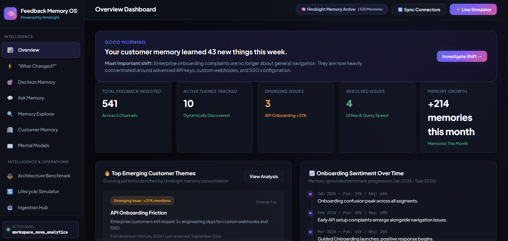

# Hindsight Showed Why Guided Onboarding Only Partially Worked

We shipped guided onboarding to solve a real problem, then discovered we had only solved the part of the problem that was easiest to see.

SMB customers stopped complaining about navigation. Enterprise customers still needed engineers to finish API and SSO setup. If I had treated the newest feedback as the whole story, I would have proposed another onboarding redesign and made the situation worse.

That is why I built Feedback Memory OS around [Hindsight agent memory](https://vectorize.io/what-is-agent-memory): not to summarize a pile of tickets, but to retain what happened before a product decision and compare it with what happened afterward. The important output is not “customers dislike onboarding.” It is: “the March UI change helped SMBs; the remaining problem is enterprise provisioning and SSO.” Those are very different engineering tasks.

## The system is a memory loop, not a feedback inbox

The application ingests feedback from support, interviews, surveys, sales calls, reviews, CSV imports, and manual entry. A FastAPI backend normalizes each event and a browser dashboard exposes timelines, customer histories, evidence search, and decision outcomes.

The central loop is deliberately simple:

1. Retain an individual feedback event with its date, customer, segment, source, product, sentiment, and theme.
2. Retain the product decision that responded to that feedback.
3. Retain later feedback using the same vocabulary.
4. Recall evidence and reflect across the resulting history.

I use [Hindsight on GitHub](https://github.com/vectorize-io/hindsight) as the memory substrate behind that loop. Its `retain`, `recall`, and `reflect` operations map cleanly to the application’s needs: save an event, retrieve the relevant trail, and synthesize an answer over the trail. The [Hindsight documentation](https://hindsight.vectorize.io/) was especially useful as a reminder that durable memory needs more than a similarity query.

The backend keeps the application boundary narrow. `MemoryService` owns domain-shaped methods such as `retain_feedback`, `retain_decision`, and `get_customer_memory`. The client wrapper owns the Hindsight API integration and an embedded implementation for local development and test isolation. The frontend does not get credentials or direct memory access.

That separation matters. I can change retrieval behavior without spreading Hindsight-specific calls across endpoint handlers, and I can test a full customer story against an empty bank without shared-state surprises.

## The hard part was recording decisions as evidence

Most feedback systems save what customers said. Many can label it and chart it. The omission that caused trouble for us was product decisions themselves.

Without a stored intervention, post-release feedback has no explicit historical anchor. A negative comment after a release could be a regression, a new issue, or the old issue persisting. A positive comment might mean the release worked for everyone, or only for the customers with simple setups.

So a decision is retained as an experience, with a timestamp, rationale, expected outcome, owner, and status:

```python
content = (
    f"Product Decision '{title}' enacted on {date}. "
    f"Rationale: {reason}. Expected outcome: {expected_outcome}. Owner: {owner}."
)

return self.client.retain(
    bank_id=target_bank,
    content=content,
    timestamp=dt,
    context="product_decision",
    document_id=decision_id,
    tags=["type:decision", f"owner:{owner.lower().strip()}"],
    memory_type="experience",
)
```

This is mundane code, but it changes the question the system can answer. Instead of asking “what do customers think about onboarding?” I can ask “did Guided Onboarding V1 accomplish its expected outcome, and for whom?”

The same treatment applies to raw feedback. I keep the customer’s statement, but give it enough structure to be retrievable later from several directions:

```python
all_tags = [
    f"source:{source.lower().strip()}",
    f"segment:{segment.lower().strip()}",
    f"product:{product.lower().strip()}",
    f"sentiment:{sentiment.lower().strip()}",
    "type:feedback",
]
if theme:
    all_tags.append(f"theme:{theme.lower().strip()}")
```

Tags are not a substitute for retrieval. They are constraints on it. Searching for “onboarding” tells me what is related; filtering with `segment:enterprise` lets me test whether that relationship holds for the people whose deployments are materially different. The structured metadata preserves the same distinction in the UI and in a response’s citations.

I also retain a separate world fact for a customer’s segment and product line. That may appear redundant, but it prevents a useful fact—“this customer is an enterprise API user”—from existing only inside one transient complaint. Experiences tell me what happened; world facts supply stable context; consolidated observations capture recurring patterns.

## The result was a partial success, not a contradiction

The incident that made this design worthwhile begins with broad onboarding complaints. Both SMB and enterprise customers reported confusing setup. We recorded the decision to launch Guided Onboarding V1, intended to reduce navigation friction.

The next feedback looked good at first. SMB users said setup was fast and clear. But enterprise feedback changed shape rather than disappearing: the UI was better, while API key role provisioning, custom webhooks, SSO, and VPC-related setup remained difficult.

That is not contradictory customer feedback. It is a segment split after an intervention. Hindsight’s reflection flow is designed to surface that split by retrieving the decision alongside evidence on both sides of it:

```python
reflection = self.client.reflect(
    bank_id=target_bank,
    query=query,
    context=context,
    tags=tags,
)

recalled = self.client.recall(
    bank_id=target_bank,
    query=query,
    tags=tags,
    limit=12,
)
```

I intentionally return the recalled evidence with the reflection. A fluent conclusion without underlying events is not useful when an engineer needs to decide whether to build an SSO template, change API defaults, or investigate a release. The `ReflectService` turns each recalled result into an evidence item with its customer, source, segment, date, and text.

For the explicit “did our fix work?” path, I do not hide the evaluation inside prose. The code fetches topic-relevant feedback, partitions it at the decision date, then counts enterprise and SMB evidence separately:

```python
before_ent = sum(1 for m in before_list
                 if "segment:enterprise" in m.get("tags", []))
after_ent = sum(1 for m in after_list
                if "segment:enterprise" in m.get("tags", []))
before_smb = sum(1 for m in before_list
                 if "segment:smb" in m.get("tags", []))
after_smb = sum(1 for m in after_list
                if "segment:smb" in m.get("tags", []))
```

Counts are not causality. They are a check against a very common failure mode: declaring a release successful because aggregate sentiment improved. The evaluation supplies the before/after evidence; reflection supplies the historical explanation; the engineer still owns the judgment.

## Retrieval has to honor time and boundaries

The local engine ranks recall results with keyword overlap, entity matches, a modest temporal signal, and a boost for consolidated observations. In a deployed installation, the Hindsight client handles the memory operations; the application still expects results to carry timestamps, metadata, tags, entities, and source identifiers.

Time is essential here. A search result from before the decision is not interchangeable with one from after it. An observation such as “enterprise API onboarding remains a bottleneck” is useful as a summary, but it must point back to the events that formed it. The implementation stores `source_fact_ids` on consolidated observations for exactly that reason.

Tenant scope is equally non-negotiable. Each workspace maps to a dedicated bank ID. A test retains a feature request in one tenant bank, recalls from another, and expects no results. I would rather make cross-tenant recall structurally impossible than rely on every caller to remember an extra filter.

Finally, customer feedback is untrusted input. Before retention, the ingestion service filters known instruction-like phrases. That is not a complete defense on its own, so the larger rule is more important: feedback remains data, and any later prompt construction must isolate it from system instructions. Memory is valuable precisely because it lasts; that makes careless ingestion more expensive.

## What I learned

- Store the intervention, not only the complaint. A decision without a retained rationale and date makes later evaluation speculative.
- Segment tags are a diagnostic tool. Aggregate improvements can conceal a worse or merely different failure mode for high-complexity customers.
- Keep synthesis attached to evidence. A reflection should make it easy to inspect the dates, sources, and statements that led to it.
- Use observations to compress recurring history, but retain the source experiences. Summaries drift; source-linked summaries can be checked and replaced.
- Treat tenant boundaries and untrusted feedback as part of the memory design, not API polish to add later.

Guided Onboarding V1 did work. It removed broad navigation friction for a meaningful group of users. Calling it a complete success would have delayed the real next project: enterprise API and SSO automation. Hindsight gave us a way to preserve that distinction long enough for it to affect the roadmap.
